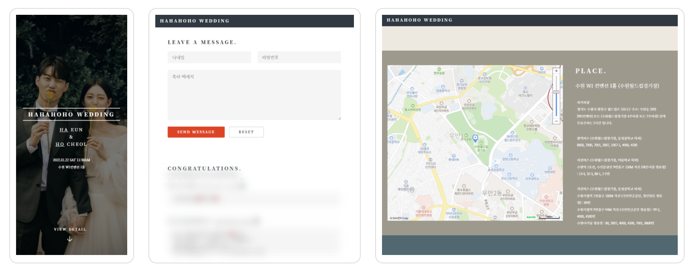
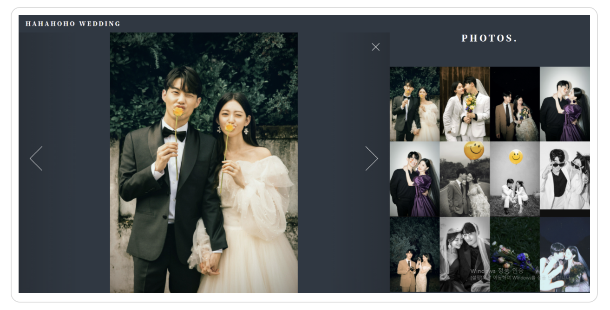

# HahaHoho Project

우리 가족 웹사이트입니다. 결혼식 청첩장과 도원이 첫 돌 예배 초대장에서 시작했습니다.

- 사이트: [www.hahahohoproject.com](https://www.hahahohoproject.com)
- 결혼식 청첩장: [/wedding.html](https://www.hahahohoproject.com/wedding.html)
- 도원이 첫 돌 예배: [/dowon.html](https://www.hahahohoproject.com/dowon.html)

## 개발

[Astro](https://astro.build)로 만든 정적 사이트이고, Node.js 22.23.4 이상이 필요합니다.

```sh
npm install
npm run dev      # 개발 서버
npm run check    # 타입 체크
npm run build    # dist/ 로 빌드
```

main 브랜치에 push하면 GitHub Actions가 빌드해서 GitHub Pages로 배포합니다.
구조와 작업 규칙은 [CLAUDE.md](./CLAUDE.md)에 있습니다.

## 화면




## 라이선스

예전 페이지의 디자인은 [HTML5 UP](https://html5up.net)의 Spectral, Lens 템플릿(CC BY 3.0)을 바탕으로 합니다.
